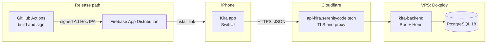
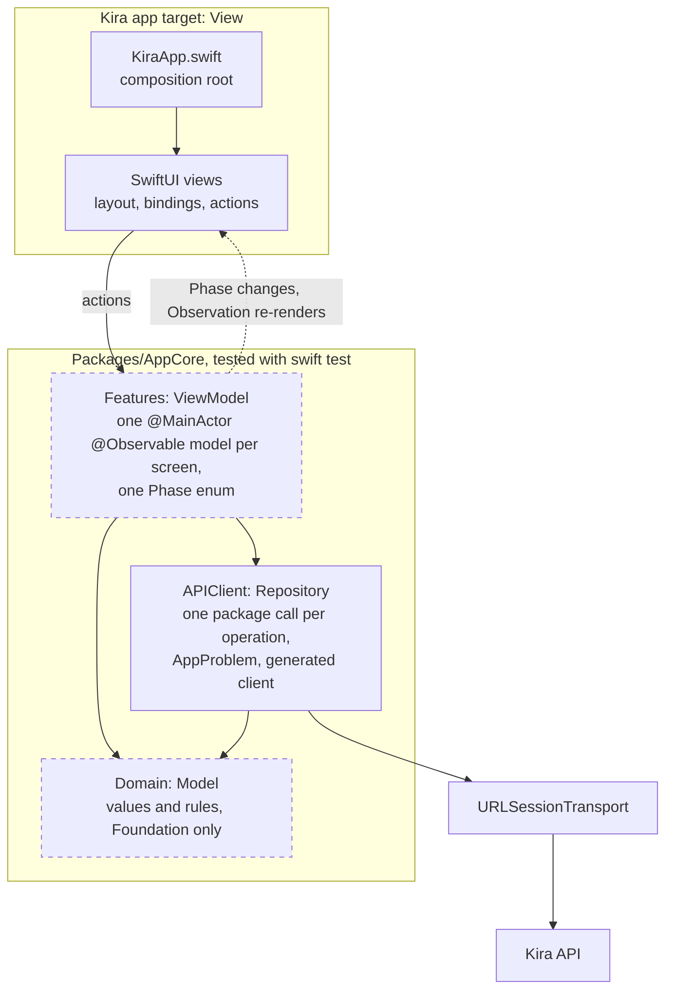
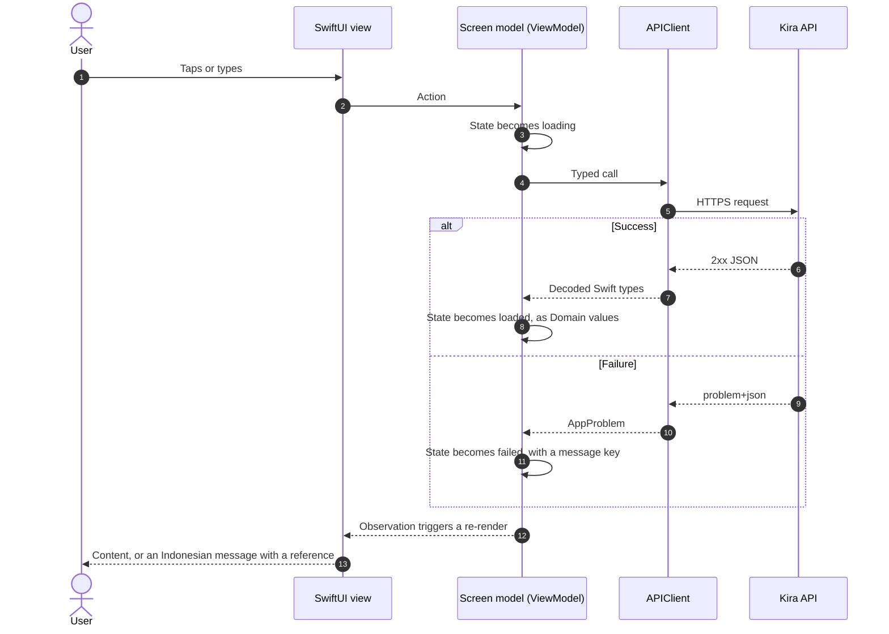
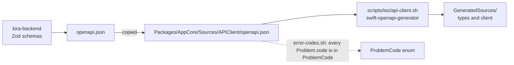
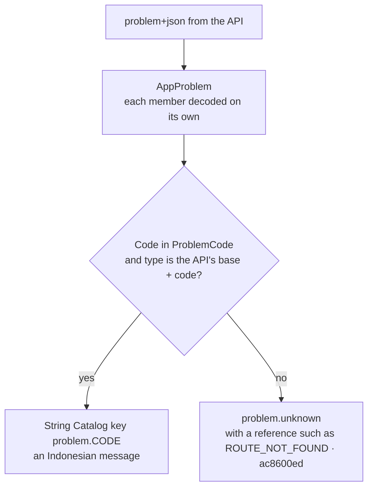
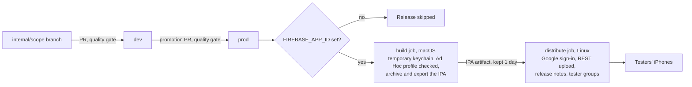

# Kira for iPhone

**Kira** is a personal-finance companion for people in Indonesia: record spending by chatting, check
your financial health, and plan ahead, all in Indonesian. This repository is the iPhone app. Its
backend is [kira-backend](https://github.com/Kira-iOS-Project/kira-backend).

> **Status.** The foundation is built: the app shell, the logic package, the API client generated
> from the backend's contract, error handling with Indonesian messages, the accessibility audit, and
> CI/CD to Firebase App Distribution. The product's screens are designed and are built one ticket at
> a time on this base ([Product scope](#product-scope)).

## Contents

- [Tech Stack](#tech-stack)
- [Product Scope](#product-scope)
- [System Design](#system-design)
- [App Architecture](#app-architecture)
- [Data Flow](#data-flow)
- [API Contract](#api-contract)
- [Error Handling](#error-handling)
- [Localization and Accessibility](#localization-and-accessibility)
- [Delivery Pipeline](#delivery-pipeline)
- [Security and Privacy](#security-and-privacy)
- [Architecture Decisions](#architecture-decisions)
- [Getting Started](#getting-started)
- [Repository Layout](#repository-layout)

## Tech Stack

| Area | Choice | Version |
| --- | --- | --- |
| Language | Swift, language mode 6 (strict concurrency), warnings as errors | Swift 6 |
| UI | SwiftUI, with Observation for screen state | |
| Platform | iOS, iPhone only | iOS 17.0 and later |
| Toolchain | Xcode | 27.0 |
| Logic package | Local Swift package `AppCore`, tested with `swift test` | swift-tools 6.2 |
| Networking | Apple's swift-openapi-generator, swift-openapi-runtime and the URLSession transport | 1.14.0, 1.13.0, 1.3.2 |
| Localization | String Catalogs, Indonesian (`id`) as the source language | |
| Unit tests | Swift Testing, 100% line and function coverage per file | |
| UI tests | XCTest with Xcode's accessibility audit | |
| Lint and format | SwiftLint, swift-format | 0.65.1, Xcode's |
| Dead code | Periphery | 3.8.0 |
| Distribution | Firebase App Distribution through its REST API, with no Firebase SDK in the app | |
| CI/CD | GitHub Actions: a Linux job for static checks, a macOS job for build and tests | |

## Product Scope

The design covers these areas; each screen becomes a ticket with the area's code. They are designed
and not yet built in this repository.

| Area | What it does |
| --- | --- |
| Masuk and Onboarding (ONB) | Sign in with an email and a one-time code, then set a PIN |
| Beranda (BRD) | Home: an overview of your money, including the bills that are due |
| Catat (CAT) | Record spending by chat, receipt photo, voice or a manual form; each saved transaction links back to the message it came from |
| Dompet, Budget, Tagihan (UNG) | Wallets, budgets and bills |
| Cek Kesehatan (SKR) | The Kira Score, computed by a deterministic engine (never by AI), with how it is calculated |
| Rencanakan (REN) | Goals and simulations |
| Terhubung (KOM) | The community |
| Kira Peduli (PED) | Support when money worries become overwhelming, including a direct call to 119 |
| Akun (AKN) | Account, privacy and subscription |

Decisions for the first release: the app is locked with a PIN (no Face ID yet), and it sends no
notifications. Due bills show inside the app instead.

## System Design



The app talks to one server, the Kira API, over HTTPS through Cloudflare. Test builds reach testers
through Firebase App Distribution, and the app itself embeds no Firebase code.

## App Architecture

**MVVM on Swift's Observation framework, in layered Swift package targets.** Each screen has a
SwiftUI view and one `@Observable` screen model (the view model). The models and everything they use
live in the `AppCore` package, whose targets form strict layers: a view cannot reach the network,
and a model cannot import SwiftUI. Data flows one way: the view sends an action, the model changes
its state, and the view re-renders from that state.



Dashed layers arrive with the first feature screen; the app target and `APIClient` exist today.

| MVVM role | In Kira | Imports |
| --- | --- | --- |
| **View** | A SwiftUI view in the app target: lays out, binds and calls its model; no I/O, clock, filtering, sorting or decisions | SwiftUI, AppCore |
| **ViewModel** | A `@MainActor @Observable` screen model in `Features`: one `Phase` enum (`loading`, `empty`, `loaded`, `failed`), async actions, display text as `LocalizedStringResource` | Observation, Domain, APIClient |
| **Model** | `Domain`: the product's values and rules (amounts, transactions, the score) | Foundation |
| **Repository** | `APIClient`: the data access behind the models, one `package` function per API operation, returning Domain values or throwing `AppProblem` | Domain, OpenAPIRuntime, OpenAPIURLSession |

### The Shape of Every Screen

The names below are examples; the first real screen follows the same shape.

```swift
// Packages/AppCore/Sources/Features/TransactionListModel.swift: the ViewModel
@MainActor @Observable
package final class TransactionListModel {
    package enum Phase { case loading, empty, loaded([Transaction]), failed(AppProblem) }

    package private(set) var phase: Phase = .loading
    private let load: () async throws -> [Transaction]

    package init(load: @escaping () async throws -> [Transaction]) { self.load = load }

    package func refresh() async {
        do {
            let transactions = try await load()
            phase = transactions.isEmpty ? .empty : .loaded(transactions)
        } catch let problem as AppProblem {
            phase = .failed(problem)
        } catch {
            phase = .failed(AppProblem())
        }
    }
}
```

```swift
// App/Screens/TransactionList/TransactionListView.swift: the View
struct TransactionListView: View {
    let model: TransactionListModel

    var body: some View {
        Group {
            switch model.phase {
            case .loading: ProgressView("transactions.loading")
            case .empty: ContentUnavailableView("transactions.empty", systemImage: "tray")
            case .loaded(let transactions): List(transactions) { TransactionRow(transaction: $0) }
            case .failed(let problem): ProblemView(problem: problem)
            }
        }
        .task { await model.refresh() }
    }
}
```

```swift
// App/KiraApp.swift: the composition root injects each model's dependencies
@main
struct KiraApp: App {
    @State private var transactions = TransactionListModel(load: KiraAPI(serverURL: server).transactions)
    var body: some Scene { WindowGroup { TransactionListView(model: transactions) } }
}
```

### Dependencies, Concurrency and Navigation

- **Dependency injection.** The composition root (`KiraApp.swift`) is the only place that knows the
  server URL and the transport. It builds each model with the functions it needs, such as
  `load: api.transactions`. There are no singletons and no service locator, so a test passes its own
  functions.
- **Concurrency.** Swift 6 language mode with strict checking. The package's code is `nonisolated` by
  default, so networking and decoding stay off the main thread; screen models are `@MainActor`,
  because the UI reads them.
- **Navigation.** Not decided yet: it is settled with the first multi-screen flow (the onboarding
  tickets). The direction is SwiftUI's `NavigationStack` with value-based destinations, owned by the
  app target, so models never import SwiftUI.

### Boundaries the Gates Enforce

| Boundary | Enforced by |
| --- | --- |
| Logic targets never import SwiftUI or UIKit | SwiftLint `no_ui_import_in_logic` |
| A target imports only the layers it lists; one feature never imports another | `scripts/check/package-graph.sh` |
| Views do no I/O, read no clock, and never filter or sort data | SwiftLint `no_io_in_view`, `no_clock_in_view`, `no_data_shaping_in_view` |
| Requests go only through the generated client; no `URLSession` elsewhere, no route literal | SwiftLint `no_urlsession_outside_transport`, `no_route_literal` |
| Errors switch over `knownCode` with no `default:`, never over the HTTP status | SwiftLint `no_default_on_problem_code`, `no_status_branch` |
| Tokens never reach `UserDefaults`; the refresh token lives in the Keychain | SwiftLint `no_token_in_user_defaults` |
| Small units: at most 150 code lines per file, 120 per type, 40 per function | SwiftLint |
| Every file of the logic targets is fully covered | `scripts/check/coverage.sh` |

### Testing per Layer

| Layer | How it is tested | What a test replaces |
| --- | --- | --- |
| Domain | Swift Testing, pure functions | Nothing |
| APIClient | Swift Testing with a canned `ClientTransport`, so the generated decoding runs for real | The transport only |
| Features | Swift Testing: call an action, then check `phase` | The system boundaries: the transport, the Keychain, the clock |
| Views | UI tests with the accessibility audit; Xcode previews | Nothing |

### Why MVVM

| Option | Decision | Reason |
| --- | --- | --- |
| **MVVM with Observation** | Chosen | Apple's direction since iOS 17: `@Observable` re-renders only what changed, with no Combine or third-party framework. Screen models are plain classes tested with `swift test` in seconds, which is what makes 100% coverage practical. |
| The Composable Architecture (TCA) | Not chosen | Excellent for large apps with complex shared state, but a large third-party dependency with its own reducers, effects and macros. For one small team, that ceremony costs more than it saves, and Observation already gives fine-grained updates. |
| VIPER or Clean Swift (VIP) | Not chosen | Designed for UIKit: five types per screen to split work that a SwiftUI view and its model already split cleanly. |
| MV (views own their state) | Not chosen | The least code, but logic in views is reachable only through a simulator, so it is slow to test and easy to leave untested. |

## Data Flow

A screen never calls the network directly. It sends an action to its model, the model calls the API
client, and the view re-renders from the model's state.



Money is handled in whole rupiah and always shown in full with two decimals, such as
`Rp10.000,00`.

## API Contract

The backend's Zod schemas produce its `openapi.json`. This repository keeps a copy, and the client is
generated from that copy, never written by hand.



When the backend changes its contract: copy its `openapi.json` here, run
`bash scripts/ios/api-client.sh`, and map any new error code in `ProblemCode`. The gate names any
code that is missing.

## Error Handling

Every API error is an [RFC 9457](https://www.rfc-editor.org/rfc/rfc9457) problem with a stable
`code`. The generated client decodes it into `AppProblem`, and the screen shows the app's own
message for that code. A code this build does not know still produces a clear message, with a short
reference a person can quote to support.



`ProblemCode` is switched over with no `default:`, so a new code fails the build until every screen
handles it.

## Localization and Accessibility

- **Indonesian first.** `App/Localizable.xcstrings` is a String Catalog whose source language is
  Indonesian. Views use catalog keys only, and a gate fails on a key that is missing or unused.
- **Accessibility.** A UI test runs Xcode's accessibility audit on the app in CI, so a missing label,
  a too-small tap target or a contrast problem fails the pull request.

## Delivery Pipeline

Two long-lived branches: `dev` collects finished work, and a merge into `prod` is a release.



The quality gate (agent-config-kit's reusable `ios-swiftui` workflow, pinned to one commit) runs on
every pull request in two jobs, so a failure that needs no Mac costs no macOS time:

| Job | Checks |
| --- | --- |
| Static, Linux | String Catalog, error codes, lint suppressions, privacy manifest, folder shape, secrets in the pull request's commits (gitleaks) |
| Build and test, macOS | Every gate, including swift-format and SwiftLint; the simulator build with zero warnings; `swift test` with the 100% coverage floor; the UI tests and accessibility audit; dead code (Periphery); the API client equals its spec |

Beside it: CodeQL, dependency review, and a workflow lint (actionlint and zizmor). The developer
machine runs the same gates in a pre-commit hook.

## Security and Privacy

- **No secrets in the app or the repository.** The app has no API keys; the signing certificate,
  profile and Google credentials are GitHub secrets.
- **Split credentials.** The build job holds only the Apple signing secrets, in a throwaway keychain
  with a random password. The distribute job holds only the Google credential. Workload Identity
  Federation is preferred over a long-lived key.
- **Checked inputs.** The workflow refuses a provisioning profile that is not Ad Hoc for this
  bundle id, and it runs only for a merged pull request from this repository.
- **Privacy manifest.** `App/PrivacyInfo.xcprivacy` declares no tracking and, so far, no collected
  data. Each feature adds what it collects and the required-reason APIs it uses, and a gate checks
  the file.
- **Supply chain.** Every Swift package is pinned to an exact version with `Package.resolved`
  committed. Every GitHub Action is pinned to a full commit SHA, and the workflow token is read-only
  unless a job asks for more.
- **Repository.** Secret scanning with push protection, Dependabot alerts, and approval before a fork's
  pull request may run workflows. `dev` and `prod` cannot be force-pushed or deleted.

## Architecture Decisions

| # | Decision | Why | Trade-off |
| --- | --- | --- | --- |
| 1 | Logic in a local Swift package, views in the app target | `swift test` runs on the Mac in seconds, with no simulator, at 100% coverage | Screen models never import SwiftUI, so view-only types stay in the app |
| 2 | MVVM: one `@Observable` screen model per screen, with one `Phase` enum | Logic testable without UI; the view re-renders only what changed; every screen has the same four states | Requires iOS 17 |
| 3 | The API client generated from the backend's OpenAPI spec | Types match the server exactly; a contract change shows up as a compile error | The spec copy is refreshed by hand when the backend changes |
| 4 | Errors decoded leniently and branched on a stable code | A new or malformed field never crashes decoding; messages are localized on the device | Each new code is mapped once in `ProblemCode` and the catalog |
| 5 | Indonesian as the String Catalog's source language | The product is for Indonesia; no English-first copy to translate back | Another language is added as a translation later |
| 6 | Swift 6 strict concurrency, warnings as errors | Data races are compile errors, not crashes | Some APIs need explicit isolation |
| 7 | Build settings in `.xcconfig` files, not the project file | Settings are reviewable text diffs; `scripts/check/xcode-settings.sh` keeps them there | Xcode's build settings editor is not the source of truth |
| 8 | Firebase App Distribution through REST, with no SDK | Nothing from Firebase ships in the app; the release needs only curl | Crash reporting and analytics, if wanted, are a separate decision |
| 9 | Sign-in with an email and a one-time code; a PIN lock; no notifications | The simplest secure flow for the first release | Face ID and reminders come later |

## Getting Started

Requirements: Xcode 27.0, SwiftLint 0.65.1 (`brew install swiftlint`), and Node 20 or newer for the
check scripts.

```bash
git config core.hooksPath .githooks          # the pre-commit gate, once per clone
open Kira.xcodeproj                           # then run the Kira scheme on an iPhone simulator
(cd Packages/AppCore && swift test)           # the logic tests, no simulator
```

| Command | What it does |
| --- | --- |
| `bash scripts/ios/app.sh build` | Builds for the simulator, unsigned, failing on any warning |
| `bash scripts/ios/app.sh test` | The app's tests, including the accessibility audit |
| `bash scripts/ios/api-client.sh` | Regenerates the API client from the spec copy |
| `bash scripts/check/gates.sh` | Every gate, as the pre-commit hook and CI run them |

Release signing and Firebase are set up once, as described in
[`docs/firebase-app-distribution.md`](docs/firebase-app-distribution.md).

## Repository Layout

```text
App/
  KiraApp.swift              the composition root
  Screens/                   SwiftUI views, one folder per screen
  Localizable.xcstrings      the String Catalog (Indonesian)
  PrivacyInfo.xcprivacy      the privacy manifest
Packages/AppCore/
  Sources/APIClient/         AppProblem, the spec copy, the generator's settings, GeneratedSources/
  Tests/APIClientTests/      Swift Testing tests
UITests/                     the accessibility audit
Config/                      Base, Debug and Release build settings
docs/                        Firebase App Distribution setup
scripts/                     the quality gates and the build helpers
```
