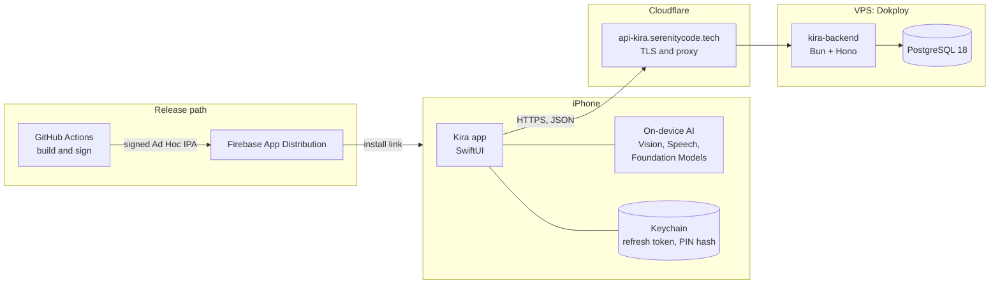
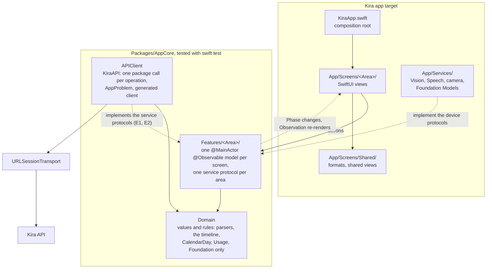
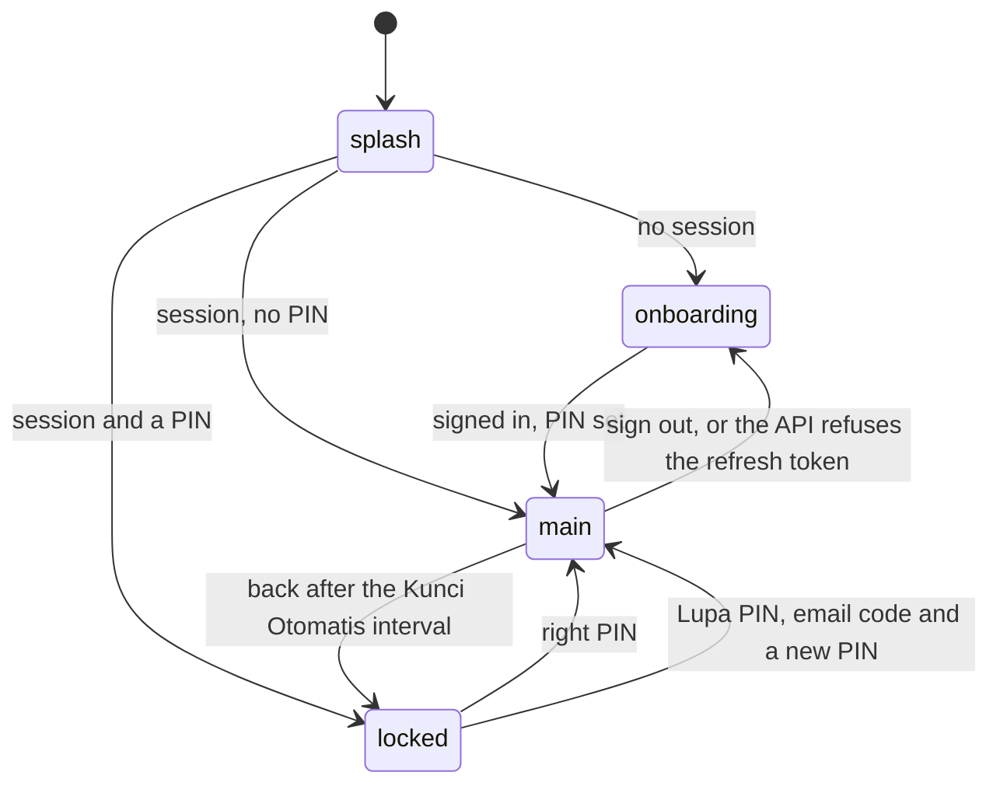
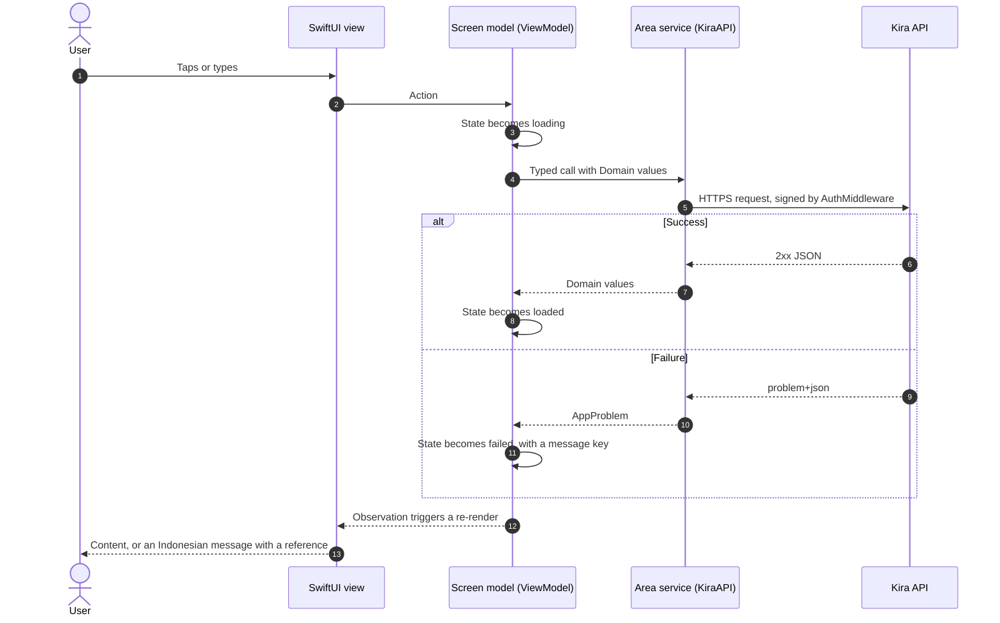
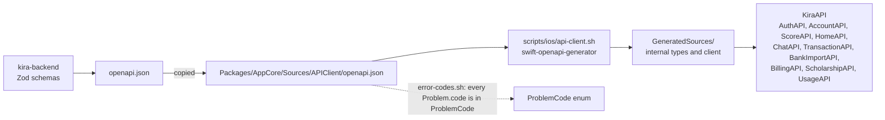
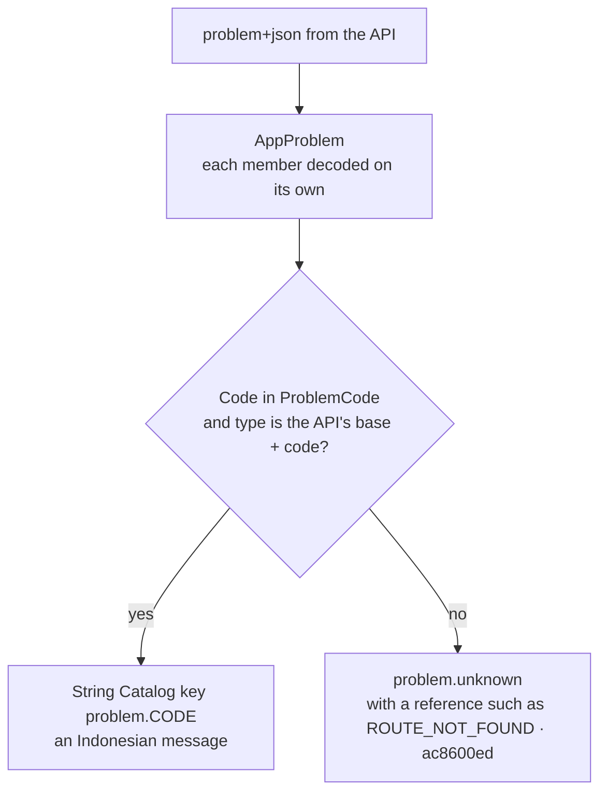
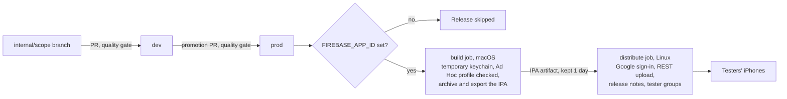

# Kira for iPhone

**Kira** is a personal-finance companion for people in Indonesia: record spending by chatting, check
your financial health, and plan ahead, all in Indonesian. This repository is the iPhone app. Its
backend is [kira-backend](https://github.com/Kira-iOS-Project/kira-backend).

> **Status.** The first flows are built: the root with its splash, onboarding and sign-in, the PIN
> lock, the tab shell, Beranda, the Kira Score, Catat (chat, receipts, voice, manual entry), Riwayat
> with transaction detail and bank-statement import, Akun, and the plans with Beasiswa Kira. Each
> area runs on a preview service today. In progress: the live services and the root wiring (E1),
> Catat on the live API (E2), an accessibility audit per screen (A1), and the Foundation Models
> gating (R2) ([Status of this round](#status-of-this-round)).

## Contents

- [Tech Stack](#tech-stack)
- [Product Scope](#product-scope)
- [System Design](#system-design)
- [App Architecture](#app-architecture)
- [Navigation and the Shell](#navigation-and-the-shell)
- [Session and App Lock](#session-and-app-lock)
- [Data Flow](#data-flow)
- [API Contract](#api-contract)
- [Error Handling](#error-handling)
- [On-device AI](#on-device-ai)
- [Screens per Area](#screens-per-area)
- [Localization and Accessibility](#localization-and-accessibility)
- [Delivery Pipeline](#delivery-pipeline)
- [Security and Privacy](#security-and-privacy)
- [Architecture Decisions](#architecture-decisions)
- [Getting Started](#getting-started)
- [Status of this Round](#status-of-this-round)
- [Repository Layout](#repository-layout)

## Tech Stack

| Area | Choice | Version |
| --- | --- | --- |
| Language | Swift, language mode 6 (strict concurrency), warnings as errors | Swift 6 |
| UI | SwiftUI, with Observation for screen state | |
| Platform | iOS, iPhone only | iOS 17.0 and later |
| Toolchain | Xcode | 27.0 |
| Logic package | Local Swift package `AppCore`, tested with `swift test` | swift-tools 6.2 |
| Networking | Apple's swift-openapi-generator, swift-openapi-runtime and the URLSession transport | 1.14.0, 1.13.0, 1.3.2 |
| On-device AI | Vision (receipt text), Speech (voice), Foundation Models (draft names and categories) | iOS 17+, 26+ for Foundation Models |
| Localization | String Catalogs, Indonesian (`id`) as the source language | |
| Unit tests | Swift Testing, 100% line and function coverage per file | |
| UI tests | XCTest with Xcode's accessibility audit | |
| Lint and format | SwiftLint, swift-format | 0.65.1, Xcode's |
| Dead code | Periphery | 3.8.0 |
| Distribution | Firebase App Distribution through its REST API, with no Firebase SDK in the app | |
| CI/CD | GitHub Actions: a Linux job for static checks, a macOS job for build and tests | |

## Product Scope

Each screen is a ticket with its area's code. Built means the screens and their models are in this
repository and run on preview data; the live API arrives with E1 and E2.

| Area | What it does | Here |
| --- | --- | --- |
| Masuk and Onboarding (ONB) | Splash, intro, sign in with an email and a one-time code, consent, focus, the health check quiz, its result, and the PIN | Built |
| Beranda (BRD) | Home: the period's money, the next step, the Kira Score card, the weekly summary, or the debt plan | Built |
| Cek Kesehatan (SKR) | The Kira Score, computed by a deterministic engine (never by AI), and each indicator's detail | Built (SKR-01, SKR-02) |
| Catat (CAT) | Record by chat, receipt photo, voice or a manual form; Riwayat with search and filters; each transaction links back to the message it came from; bank-statement import | Built |
| Akun (AKN) | Profil, Keamanan (the PIN and the lock), Data dan Privasi, Hapus Akun, Tentang Kira and its documents; Paket, payment (simulated), Langganan, Traktir Kira and Beasiswa Kira | Built |
| Dompet, Budget, Tagihan (UNG) | Wallets, budgets and bills | Designed, not built |
| Rencanakan (REN) | Goals and simulations | Designed, not built |
| Terhubung (KOM) | The community | Designed, not built |
| Kira Peduli (PED) | Support when money worries become overwhelming, including a direct call to 119 | Designed, not built |

Links to an area not built stay visible as designed and open nothing (`AppRoute.unavailable`).
Decisions for the first release: sign-in by email and a code, a PIN lock (no Face ID), no app
notifications (transactional email only), and payments as simulations.

## System Design



The app talks to one server, the Kira API, over HTTPS through Cloudflare. Reading a chat message,
a receipt or a voice note happens on the iPhone; the server receives text and validates the
amounts. Test builds reach testers through Firebase App Distribution, and the app embeds no
Firebase code.

## App Architecture

**MVVM on Swift's Observation framework, in layered Swift package targets.** Each screen has a
SwiftUI view and one `@Observable` screen model (the view model). The models and everything they use
live in the `AppCore` package, whose targets form strict layers: a view cannot reach the network,
and a model cannot import SwiftUI. Data flows one way: the view sends an action, the model changes
its state, and the view re-renders from that state.



| MVVM role | In Kira | Imports |
| --- | --- | --- |
| **View** | A SwiftUI view in `App/Screens/<Area>/`: lays out, binds and calls its model; no I/O, clock, filtering, sorting or decisions | SwiftUI, AppCore |
| **ViewModel** | A `@MainActor @Observable` screen model in `Features/<Area>/`: one phase enum (`ScreenPhase`: `loading`, `empty`, `loaded`, `failed`, or the screen's own), async actions | Observation, Domain, APIClient |
| **Model** | `Domain`: the product's values and rules (amounts, transactions, the chat parsers, the score, WIB days) | Foundation |
| **Repository** | An area's service protocol (`HomeService`, `RecordService`, `HistoryService`, …) in `Features`, implemented on `KiraAPI` in `APIClient`; one `package` function per API operation, returning Domain values or throwing `AppProblem` | Domain, OpenAPIRuntime, OpenAPIURLSession |

### The Shape of Every Screen

Every screen follows this shape; Riwayat Percakapan is one of the smallest.

```swift
/** Packages/AppCore/Sources/Features/History/ViewModels/ConversationModel.swift: the ViewModel */
@MainActor @Observable
package final class ConversationModel {
    package private(set) var phase: ScreenPhase<[ConversationBlock]> = .loading
    private let service: any HistoryService

    package init(sourceMessageId: String, service: any HistoryService) { ... }

    package func load() async {
        do {
            let messages = try await service.messages(around: sourceMessageId)
            let blocks = Self.blocks(messages, source: sourceMessageId)
            phase = blocks.isEmpty ? .empty : .loaded(blocks)
        } catch {
            phase = .failed(historyProblem(error))
        }
    }
}
```

```swift
/** App/Screens/History/Views/ConversationScreen.swift: the View */
struct ConversationScreen: View {
    @State private var model: ConversationModel

    var body: some View {
        ScrollView {
            switch model.phase {
            case .loading: ProgressView()
            case .empty: Text("conversation.empty")
            case .loaded(let blocks): ForEach(blocks) { ConversationBlockView(block: $0) }
            case .failed(let problem): LoadFailedView(problem: problem) { Task { await model.load() } }
            }
        }
        .task { await model.load() }
    }
}
```

An area's entry view takes its service and a callback for navigation out, such as
`HistoryScreen(service:onOpen:)`, so the area never knows the rest of the app.

### Dependencies and Concurrency

- **Dependency injection.** The composition root (`KiraApp.swift`) is the only place that knows the
  server URL and the transport. It builds the session, the lock and the root model, and each area
  receives its service protocol. Every area ships a preview service with the canvas's sample data
  (`App/Screens/<Area>/Preview/`), so its screens run in previews and in the app before the live
  service exists. There are no singletons and no service locator.
- **Concurrency.** Swift 6 language mode with strict checking. The package's code is `nonisolated` by
  default, so networking and decoding stay off the main thread; screen models are `@MainActor`,
  because the UI reads them. Riwayat drops a list response that answers after a newer filter or
  search started, so a slow answer never shows the wrong filter.

### Boundaries the Gates Enforce

| Boundary | Enforced by |
| --- | --- |
| Logic targets never import SwiftUI or UIKit | SwiftLint `no_ui_import_in_logic` |
| A target imports only the layers it lists; one feature never imports another | `scripts/check/package-graph.sh` |
| Views do no I/O, read no clock, and never filter or sort data | SwiftLint `no_io_in_view`, `no_clock_in_view`, `no_data_shaping_in_view` |
| Requests go only through the generated client; no `URLSession` elsewhere, no route literal | SwiftLint `no_urlsession_outside_transport`, `no_route_literal` |
| Errors switch over `knownCode` with no `default:`, never over the HTTP status | SwiftLint `no_default_on_problem_code`, `no_status_branch` |
| Tokens never reach `UserDefaults`; the refresh token lives in the Keychain | SwiftLint `no_token_in_user_defaults` |
| Small units: at most 150 code lines per file, 120 per type, 40 per function | SwiftLint |
| Every file of the logic targets is fully covered | `scripts/check/coverage.sh` |

### Testing per Layer

| Layer | How it is tested | What a test replaces |
| --- | --- | --- |
| Domain | Swift Testing, pure functions (the parsers, the timeline, `CalendarDay`, the CSV reader) | Nothing |
| APIClient | Swift Testing with a canned `ClientTransport`, so the generated decoding runs for real | The transport only |
| Features | Swift Testing: call an action, then check the phase | The system boundaries: the area's service, the Keychain (`InMemoryVault`), the clock, the device |
| Views | UI tests with the accessibility audit; Xcode previews on the preview services | Nothing |

### Why MVVM

| Option | Decision | Reason |
| --- | --- | --- |
| **MVVM with Observation** | Chosen | Apple's direction since iOS 17: `@Observable` re-renders only what changed, with no Combine or third-party framework. Screen models are plain classes tested with `swift test` in seconds, which is what makes 100% coverage practical. |
| The Composable Architecture (TCA) | Not chosen | Excellent for large apps with complex shared state, but a large third-party dependency with its own reducers, effects and macros. For one small team, that ceremony costs more than it saves, and Observation already gives fine-grained updates. |
| VIPER or Clean Swift (VIP) | Not chosen | Designed for UIKit: five types per screen to split work that a SwiftUI view and its model already split cleanly. |
| MV (views own their state) | Not chosen | The least code, but logic in views is reachable only through a simulator, so it is slow to test and easy to leave untested. |

## Navigation and the Shell

`RootModel` decides the stage; `RootView` draws it and reports the scene phase to the lock.



- **The shell.** `MainShell` puts Beranda and Catat under Kira's dock (`KiraTabBar`), each with its
  own `NavigationStack` driven by `[AppRoute]` paths in `NavigationModel`. Rencana and Komunitas
  stay on the dock and open nothing yet. The dock shows at each root and on the screens whose
  board draws it (`NavigationModel.showsDock`: Kira Score, Input Suara, Riwayat Percakapan).
- **Routes.** `AppRoute` (in `Features/Navigation`) lists every destination. Screens call
  `onOpen(AppRoute)`; `.home` and `.record` switch sections, every other route is pushed on the
  open section's stack, and `.unavailable(area)` does nothing.
- **Slots.** Each area's entry view plugs into its slot in `App/Screens/Navigation/Components/AreaSlots.swift`.
  The slots are empty surfaces until the root wires the areas with their live services (E1, in
  progress).

## Session and App Lock

- **Session.** `SessionStore` keeps the refresh token and the account's email in the vault (the
  Keychain, `kSecAttrAccessibleAfterFirstUnlockThisDeviceOnly`) and the bearer token in memory. It
  is the client's `BearerTokenSource`: `AuthMiddleware` signs every request except the code and
  refresh operations, and on a 401 asks the session for a renewed token once, shared by every
  request waiting on it. When the API refuses the refresh token, the session ends and the root
  returns to sign-in.
- **PIN.** `PinStore` keeps a random salt and the SHA-256 of salt and PIN in the vault, never
  anything readable. Five wrong tries pause the lock for 30 seconds, and the count survives a
  restart. Lupa PIN proves the account with an email code and sets a new PIN; the data stays.
- **Lock.** `AppLockModel` locks at launch when a PIN is set and when Kira returns from the
  background after the Kunci Otomatis interval (Segera, 1 menit, 5 menit). "Sembunyikan Saldo saat
  Membuka" starts every open with amounts hidden, and "Samarkan di Pengalih Aplikasi" blurs Kira in
  the app switcher (`PrivacyCover`).

## Data Flow

A screen never calls the network directly. It sends an action to its model, the model calls its
area's service, and the view re-renders from the model's state.



Money is handled in whole rupiah and always shown in full with two decimals, such as
`Rp10.000,00`. Dates are WIB days (`CalendarDay`), written in full in Indonesian ("Kamis, 15 Oktober
2026 · 12.41 WIB") whatever the device's region.

## API Contract

The backend's Zod schemas produce its `openapi.json`. This repository keeps a copy, and the client is
generated from that copy, never written by hand.



The generated types stay `internal`. `KiraAPI` has one extension per tag with a `package` call per
operation, which maps the generated output to the target's own values (`…DTO`) or throws
`AppProblem`. The area services in `Features` translate those values to Domain types (E1 and E2,
in progress). When the backend changes its contract: copy its `openapi.json` here, run
`bash scripts/ios/api-client.sh`, and map any new error code in `ProblemCode`. The gate names any
code that is missing.

## Error Handling

Every API error is an [RFC 9457](https://www.rfc-editor.org/rfc/rfc9457) problem with a stable
`code`. The generated client decodes it into `AppProblem`, and the screen shows the app's own
message for that code. A code this build does not know still produces a clear message, with a short
reference a person can quote to support.



Screens show a problem through the shared `AppProblem.message` and `LoadFailedView`
(`App/Screens/Shared/`). An action that fails over the network, such as saving an edit, shows the
board's "Belum Berhasil Menyimpan" dialog, keeps what the person entered, and offers Coba Lagi.

## On-device AI

Kira reads a person's words, receipts and voice on the iPhone. Nothing is sent to an AI service,
nothing costs money per request, and Private Cloud Compute is never used. The server receives the
resulting text and drafts, and validates every amount.

| Input | On the device | Where |
| --- | --- | --- |
| Chat text | The slang rules read every draft and its amount ("makan siang 25rb, grab ke kantor 18rb, kopi goceng" is three expenses), keeping the span each came from | `Domain/Record/DraftTextParser`, `CategoryKeywords`, `MessageReader` |
| Draft names and categories | Apple's Foundation Models may tidy each draft's name and category; it is never asked for an amount, so the rules' amounts stay | `App/Services/Record/FoundationModelsRefiner` (iOS 26 and later) |
| Receipt photo | Vision reads the printed lines; the rules read the store, the items, discounts and the TOTAL; account and card numbers are masked before any text leaves the device; the photo stays in memory and is gone once read | `App/Services/Record/VisionReceiptReader`, `Domain/Record/ReceiptTextParser`, `Domain/Privacy/SensitiveNumbers` |
| Voice note | SpeechAnalyzer in Indonesian on iOS 26 and later, else SFSpeechRecognizer with on-device recognition required; a device that cannot recognise Indonesian offline refuses rather than send audio anywhere; the audio is not kept | `App/Services/Record/DeviceVoiceTranscriber` |
| Bank statement CSV | Parsed and checked on the device; account numbers masked; a category suggested from a keyword table | `Domain/Import/BankStatementParser`, `CategorySuggestion` |

The model is optional: without it (before iOS 26, Apple Intelligence off, the model not
downloaded, or an error), the rules' drafts are sent as they are. In progress (R2): the model is
used only when `SystemLanguageModel.supportsLocale` reports Indonesian, and on iOS 27 its image
understanding may only suggest a receipt's store name, never a number. With the "Kira AI" consent
off, chat, receipt and voice reading are disabled and Catat Manual still works. Plan quotas (AI
messages, receipts, voice seconds) are product tiers counted by the server, not costs.

## Screens per Area

| Area | Entry view and screens (`App/Screens/…`) | Models (`Features/…`) |
| --- | --- | --- |
| Root and Lock | `Root/RootView`, `MainShell`, `PrivacyCover`; `Lock/LockScreen`, `PinRecoveryFlow` | `Navigation/RootModel`, `NavigationModel`; `Lock/AppLockModel`, `UnlockModel`, `PinRecoveryModel`, `PinStore` |
| Onboarding (ONB) | `Onboarding/Shared/OnboardingFlow`: splash, intro, sign-up and sign-in, the email code, consent, focus, the six-step health check, its result, the PIN | `Onboarding/OnboardingFlowModel`, `HealthCheckModel`, `CodeVerificationModel`, … |
| Beranda (BRD) | `Home/HomeScreen`: new person, overview, debt plan | `Home/HomeModel` |
| Kira Score (SKR) | `Score/ScoreScreen`, `IndicatorScreen` | `Score/ScoreModel`, `IndicatorModel` |
| Catat (CAT) | `Record/RecordScreen`: the chat, the draft edit sheet, Catat Manual, Scan Struk, the voice panel, the quota sheet | `Record/RecordModel`, `DraftEditModel`, `ManualEntryModel`, `ReceiptScanModel`, `VoiceInputModel` |
| Riwayat (CAT) | `History/HistoryScreen(service:onOpen:)`: Riwayat, Detail Transaksi, Riwayat Percakapan; `Import/StatementImportScreen`, `ImportReviewScreen` | `History/HistoryModel`, `TransactionDetailModel`, `ConversationModel`; `Import/StatementImportModel`, `ImportReviewModel` |
| Akun (AKN) | `Account/ProfileScreen`, `SecurityScreen`, `PrivacyScreen`, `AboutScreen` and the documents; `Plans/…` for Paket, checkout, Langganan, payment method, invoices, Traktir Kira, Beasiswa Kira | `Account/ProfileModel`, `SecurityModel`, `PrivacyModel`, `DeleteAccountModel`; `Plans/PlansModel`, `CheckoutModel`, `SubscriptionModel`, `ScholarshipModel`, … |

Helpers two areas share live once in `App/Screens/Shared/` (dates, the load-failed view, plan and
category names, problem messages), described in
[`docs/design-system.md`](docs/design-system.md#shared-screen-helpers).

## Localization and Accessibility

- **Indonesian first.** `App/Localizable.xcstrings` is a String Catalog whose source language is
  Indonesian. Views use catalog keys only, and a gate fails on a key that is missing or unused.
- **Accessibility.** UI tests run Xcode's accessibility audit in CI on the design system's gallery,
  the root and the lock screen, so a missing label, a too-small tap target or a contrast problem
  fails the pull request. One audit per primary screen arrives with A1 (in progress).

## Delivery Pipeline

Two long-lived branches: `dev` collects finished work, and a merge into `prod` is a release.



The quality gate (agent-config-kit's reusable `ios-swiftui` workflow, pinned to one commit) runs on
every pull request in two jobs, so a failure that needs no Mac costs no macOS time:

| Job | Checks |
| --- | --- |
| Static, Linux | String Catalog, error codes, lint suppressions, privacy manifest, folder shape, secrets in the pull request's commits (gitleaks) |
| Build and test, macOS | Every gate, including swift-format and SwiftLint; the simulator build with zero warnings; `swift test` with the 100% coverage floor; the UI tests and accessibility audit; dead code (Periphery); the API client equals its spec |

Beside it: CodeQL, dependency review, and a workflow lint (actionlint and zizmor). The developer
machine runs the same gates in a pre-commit hook.

## Security and Privacy

- **No secrets in the app or the repository.** The app has no API keys; the signing certificate,
  profile and Google credentials are GitHub secrets.
- **Tokens and the PIN.** The refresh token is a Keychain item readable only on this device after
  the first unlock; the bearer token lives in memory. The PIN is stored only as a salted hash.
- **On-device reading.** Chat text, receipt photos and voice are read on the iPhone; photos and
  audio are never stored or sent, and account and card numbers are masked before any text leaves
  the device ([On-device AI](#on-device-ai)).
- **Split credentials.** The build job holds only the Apple signing secrets, in a throwaway keychain
  with a random password. The distribute job holds only the Google credential. Workload Identity
  Federation is preferred over a long-lived key.
- **Checked inputs.** The workflow refuses a provisioning profile that is not Ad Hoc for this
  bundle id, and it runs only for a merged pull request from this repository.
- **Privacy manifest.** `App/PrivacyInfo.xcprivacy` declares no tracking. Each feature adds what it
  collects and the required-reason APIs it uses, and a gate checks the file.
- **Supply chain.** Every Swift package is pinned to an exact version with `Package.resolved`
  committed. Every GitHub Action is pinned to a full commit SHA, and the workflow token is read-only
  unless a job asks for more.
- **Repository.** Secret scanning with push protection, Dependabot alerts, and approval before a fork's
  pull request may run workflows. `dev` and `prod` cannot be force-pushed or deleted.

## Architecture Decisions

| # | Decision | Why | Trade-off |
| --- | --- | --- | --- |
| 1 | Logic in a local Swift package, views in the app target | `swift test` runs on the Mac in seconds, with no simulator, at 100% coverage | Screen models never import SwiftUI, so view-only types stay in the app |
| 2 | MVVM: one `@Observable` screen model per screen, with one phase enum | Logic testable without UI; the view re-renders only what changed; every screen has the same states | Requires iOS 17 |
| 3 | The API client generated from the backend's OpenAPI spec | Types match the server exactly; a contract change shows up as a compile error | The spec copy is refreshed by hand when the backend changes |
| 4 | Errors decoded leniently and branched on a stable code | A new or malformed field never crashes decoding; messages are localized on the device | Each new code is mapped once in `ProblemCode` and the catalog |
| 5 | Indonesian as the String Catalog's source language | The product is for Indonesia; no English-first copy to translate back | Another language is added as a translation later |
| 6 | Swift 6 strict concurrency, warnings as errors | Data races are compile errors, not crashes | Some APIs need explicit isolation |
| 7 | Build settings in `.xcconfig` files, not the project file | Settings are reviewable text diffs; `scripts/check/xcode-settings.sh` keeps them there | Xcode's build settings editor is not the source of truth |
| 8 | Firebase App Distribution through REST, with no SDK | Nothing from Firebase ships in the app; the release needs only curl | Crash reporting and analytics, if wanted, are a separate decision |
| 9 | Sign-in with an email and a one-time code; a PIN lock; no notifications | The simplest secure flow for the first release | Face ID and reminders come later |
| 10 | Navigation by value: `AppRoute` paths per tab in `NavigationModel`, `onOpen(AppRoute)` out of each area | Models decide where to go without importing SwiftUI; areas never import each other | Every destination is listed once in `AppRoute` |
| 11 | One service protocol per area, with a preview service in the app | Screens run and are tested before the live API exists; the client stays behind one seam | The live implementation maps DTOs to Domain once per area |
| 12 | AI on the device only, rules first | Free, private, and offline; the rules decide every amount, so the server can validate them | Older devices get the rules without the model's tidier names |
| 13 | Shared types and helpers exist once (`Domain` values, `App/Screens/Shared/`) | Areas built in parallel agree on one `CalendarDay`, `Usage`, date format and category name | A helper moves to Shared as soon as a second area needs it |

## Getting Started

Requirements: Xcode 27.0, SwiftLint 0.65.1 (`brew install swiftlint`), and Node 20 or newer for the
check scripts.

```bash
git config core.hooksPath .githooks          # the pre-commit gate, once per clone
open Kira.xcodeproj                           # then run the Kira scheme on an iPhone simulator
(cd Packages/AppCore && swift test)           # the logic tests, no simulator
```

| Command | What it does |
| --- | --- |
| `bash scripts/ios/app.sh build` | Builds for the simulator, unsigned, failing on any warning |
| `bash scripts/ios/app.sh test` | The app's tests, including the accessibility audit |
| `bash scripts/ios/api-client.sh` | Regenerates the API client from the spec copy |
| `bash scripts/check/gates.sh` | Every gate, as the pre-commit hook and CI run them |

Debug launch arguments (the Kira scheme lists `-KiraGallery`, off; add the others under Run ›
Arguments):

| Argument | Opens |
| --- | --- |
| `-KiraGallery [page]` | The design system's gallery instead of the app, optionally on one page (`-KiraGallery chat`) |
| `-KiraLocked` | The app signed in as the sample person with the PIN 381449, in memory only, on the lock screen |
| `-KiraScreen <name>` | One screen on its preview service, for previews by hand and the per-screen audit (A1, in progress) |

Release builds compile none of them. Release signing and Firebase are set up once, as described in
[`docs/firebase-app-distribution.md`](docs/firebase-app-distribution.md).

## Status of this Round

| Work | State | Scope |
| --- | --- | --- |
| Foundation, design system, shell, session and lock | Done | `RootView`, `MainShell`, `SessionStore`, `AppLockModel`, `PinStore` |
| Areas (ONB, BRD, SKR-01/02, CAT, AKN) | Done, on preview services | Every screen, its model and its preview service |
| One copy of each shared type and helper | Done | `CalendarDay`, `Usage`, `AmountInput`, `PayPeriod`, `DayRange`, `ChatMessage`; `App/Screens/Shared/` |
| E1: live services and `RootView` | In progress | `KiraAPI` behind each area's service protocol, the session's refresh through the client, each slot filled with its area |
| E2: live Catat | In progress | `RecordService` and the chat history on the live API |
| A1: accessibility audit per screen | In progress | A UI test per primary screen, reached with `-KiraScreen` |
| R2: Foundation Models gating | In progress | `supportsLocale` for Indonesian; on iOS 27 the model's vision assists only a receipt's store name |

## Repository Layout

```text
App/
  KiraApp.swift              the composition root
  Screens/<Area>/            Views/, Components/, Copy/, Preview/ (docs/architecture.md)
  Screens/Navigation/        RootView, MainShell, the privacy cover, the route slots
  Screens/Shared/            helpers several areas share (formats, LoadFailedView, names)
  Services/<Area>/           Vision, Speech, the camera, Foundation Models, the Keychain
  DesignSystem/              tokens, type, artwork, the Kira… components, the gallery
  Localizable.xcstrings      the String Catalog (Indonesian)
  PrivacyInfo.xcprivacy      the privacy manifest
Packages/AppCore/
  Sources/Domain/<Area>/     Models/ and Logic/: values and rules, Foundation only
  Sources/Features/<Area>/   ViewModels/ and Services/{Protocols,Live}/
  Sources/APIClient/         KiraAPI, AppProblem, the spec copy, GeneratedSources/
  Tests/                     Swift Testing tests, one target per library target
UITests/                     the accessibility audits
Config/                      Base, Debug and Release build settings
docs/                        the design system, Firebase App Distribution setup, build settings
scripts/                     the quality gates and the build helpers
```
